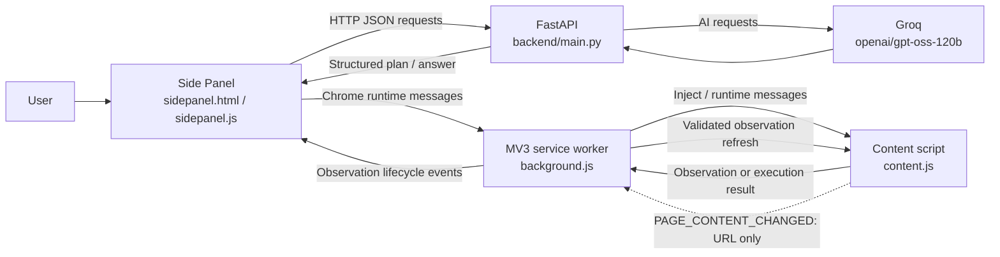

# AI Browser Assistant Master Context

This is a handover document for understanding and continuing the AI Browser Assistant project. It describes the repository as inspected on 2026-10-31. Treat the current source code and tests as authoritative where older project notes disagree.

## 1. Project Overview

### Purpose

AI Browser Assistant is a Chrome Manifest V3 extension with a local FastAPI backend. A user gives an instruction in the extension Side Panel; the backend can use Groq to interpret supported tasks and make plans, while the extension performs browser and page interactions under explicit validation and user confirmation.

The project addresses the gap between a language-model plan and the user's actual browser: the backend cannot access the browser DOM or Chrome APIs directly, so the extension observes pages and executes only supported, validated operations.

### User interaction

The extension toolbar opens a persistent Side Panel. The user can:

- Enter a supported task such as opening a website.
- Observe the active webpage, then ask a question grounded in that observation.
- Request a search on the observed page, review a search confirmation, and confirm or cancel it.
- Request a click plan for an observed target, review a click confirmation, and confirm or cancel it.

Observation and browser access are permission-gated. Click execution and search submission are distinct flows with their own checks.

### Current capabilities and boundaries

- Website opening: implemented.
- Page observation and page Q&A: implemented.
- User-confirmed search through a supported same-origin GET form: implemented.
- Context-aware click planning and confirmed click dispatch: implemented, with form-submit controls excluded.
- Dynamic DOM and SPA change notifications followed by background refresh: implemented in the current working tree; real-Chrome behavior remains to be verified.
- General form filling, arbitrary JavaScript, and autonomous multi-step browser task execution: not implemented.

## 2. Technology Stack

| Area | Technology |
|---|---|
| Browser extension | Chrome Extension Manifest V3; minimum Chrome version 116 |
| Extension UI | HTML, CSS, vanilla JavaScript; Chrome Side Panel |
| Extension runtime | Service worker (`extension/background.js`) and injected content script (`extension/content.js`) |
| Backend | Python, FastAPI, Pydantic, Uvicorn |
| AI provider | Groq Python SDK; model configured in code as `openai/gpt-oss-120b` |
| Backend configuration | `python-dotenv`; `GROQ_API_KEY` read from `backend/.env` |
| Backend tests | Python `unittest` and FastAPI `TestClient` |
| Extension tests | Node.js built-in test runner (`node:test`), with mocked Chrome APIs and VM execution |

There is no root `package.json` or backend `requirements.txt` in the inspected project. The local backend virtual environment contains the dependencies used for development. Do not copy or publish values from `.env`.

## 3. Project Architecture

### Component responsibilities

- **Side Panel:** accepts user instructions; displays observations, answers, and confirmation cards; validates backend plans against the current observation; obtains explicit confirmation before search or click execution.
- **Background service worker:** owns Chrome API orchestration, access and watch state, navigation, content-script injection, relays, active-tab checks, and automatic observation refresh.
- **Content script:** reads page DOM information, issues opaque target IDs, validates live targets immediately before use, dispatches supported click/search interactions, and emits lightweight page-change signals.
- **FastAPI backend:** accepts bounded observations and user intent; invokes Groq for supported planning tasks; checks the result against observed targets and supported policy.
- **Groq:** performs language interpretation, question answering, search planning, and click planning. Its output is untrusted and is not executed directly.

### Architecture and main data flow



### Trust boundaries

1. Page text, labels, attributes, and AI output are untrusted.
2. The backend may propose only an opaque ID from the supplied observation; backend validation rejects IDs outside the eligible candidate set.
3. The Side Panel checks a click plan against its exact current observation before showing confirmation.
4. The background service worker accepts approved click requests only from the extension Side Panel and rechecks the active tab, URL, permission, and metadata.
5. The content script resolves the opaque ID to a live DOM reference and performs final document, identity, visibility, enabled-state, and action safety checks.
6. User confirmation is required for every planned click and search submission. There is no automatic action retry.

## 4. Folder Structure

```text
ai-browser-assistant/
|-- backend/
|   |-- main.py
|   |-- test_search_automation.py
|   |-- test_groq.py
|   |-- .env                 # local secret; never commit/share
|   `-- .venv/               # local Python environment; not source
|-- extension/
|   |-- manifest.json
|   |-- sidepanel.html
|   |-- sidepanel.js
|   |-- background.js
|   |-- content.js
|   `-- tests/
|       |-- background-click-execution.test.js
|       |-- background.test.js
|       |-- content-search-targets.test.js
|       |-- sidepanel-click-confirmation.test.js
|       |-- sidepanel-permissions.test.js
|       `-- sidepanel-search-confirmation.test.js
|-- .gitignore
|-- README.md
|-- AI_Browser_Assistant_Progress.md
|-- CLICK_AUTOMATION_PROBLEMS.md
`-- AI_BROWSER_ASSISTANT_MASTER_CONTEXT.md
```

- [`backend/main.py`](./backend/main.py): API schemas, Groq calls, prompt construction, candidate filtering/ranking, plan validation, search evidence verification, and provider error handling.
- [`backend/test_search_automation.py`](./backend/test_search_automation.py): backend tests for endpoints, provider errors, click planning/ranking, search planning, and verification.
- [`backend/test_groq.py`](./backend/test_groq.py): standalone Groq connectivity diagnostic. It may make a live provider request; it was not run as part of the test results below.
- [`extension/manifest.json`](./extension/manifest.json): MV3 configuration, permissions, Side Panel, background worker, and backend host permission.
- [`extension/sidepanel.html`](./extension/sidepanel.html) and [`extension/sidepanel.js`](./extension/sidepanel.js): Side Panel interface and client-side orchestration.
- [`extension/background.js`](./extension/background.js): trusted Chrome API and tab orchestration.
- [`extension/content.js`](./extension/content.js): page observation, target registry, page-change signals, and live click/search checks.
- [`extension/tests/`](./extension/tests/): Node test suites for extension execution, observation lifecycle, permission/access, and confirmations.
- [`README.md`](./README.md): project description and setup notes. It is older than parts of the implementation.
- [`AI_Browser_Assistant_Progress.md`](./AI_Browser_Assistant_Progress.md): development notes. Its opening status and limitations are stale in places (for example, they say click execution is not implemented); verify claims against code.
- [`CLICK_AUTOMATION_PROBLEMS.md`](./CLICK_AUTOMATION_PROBLEMS.md): recorded click-automation failure modes and prior fixes.
- [`.gitignore`](./.gitignore): excludes `backend/.env`, `backend/.venv/`, and Python cache files.

## 5. Browser Extension Components

### `sidepanel.html`

Defines the instruction input, task output, current-page observation display, question UI, click planner and click confirmation card, and search UI and search confirmation card. Confirmation cards show the action or query and target description; they do not display typed form values.

### `sidepanel.js`

- Sends task, page-question, search-planning, click-planning, and search-verification requests to `http://127.0.0.1:8000`.
- Requests an observation through `OBSERVE_ACTIVE_TAB`.
- Builds a bounded JSON page payload from the content-script observation.
- Checks click-plan IDs and metadata against the current observation before presenting a confirmation.
- Holds expiring, single-use click approval state in Side Panel memory; Cancel clears pending state.
- Sends approved execution requests through `chrome.runtime.sendMessage`.
- Tracks the active tab and invalidates pending plans when the tab, URL, or observation changes.
- Handles `PAGE_OBSERVATION_INVALIDATED`, `PAGE_OBSERVATION_UPDATED`, and `PAGE_OBSERVATION_FAILED`.

The click-planning fetch path safely parses response text, checks HTTP status, handles structured backend messages, and avoids exposing JSON parse exceptions. Task, question, and search request paths do not all use that same safe response parser.

### `background.js`

- Opens the Side Panel on toolbar click and stores a short-lived `activeTab` grant in `chrome.storage.session`.
- Performs active-tab observation and content-script injection.
- Tracks watched tab IDs and authorized origins in session storage.
- Handles tab activation, navigation/reload, and removal lifecycle events.
- Verifies sender, frame, URL, watch, origin, active-tab, and permission scope for `PAGE_CONTENT_CHANGED`.
- Debounces/coalesces automatic observation refreshes, prevents overlap, and schedules one final refresh if changes arrive while a refresh is in flight.
- Routes search execution and Side Panel-approved clicks to the active tab's content script.
- Does not request new site permission automatically during a refresh.

### `content.js`

- Observes visible text, interactive controls, accessible labels/roles, semantic landmark/ancestor context, form metadata, and search-result evidence.
- Caps an observation at 12,000 characters of visible text and 100 interactive elements.
- Registers observed elements under random UUID-shaped `target-...` IDs in a content-script memory map, retaining a direct DOM reference, document token, URL, timestamp, and identity snapshot.
- Handles `OBSERVE_PAGE`, `INVALIDATE_SEARCH_TARGETS`, `PING_CLICK_EXECUTOR`, `EXECUTE_SEARCH`, and `EXECUTE_APPROVED_CLICK`.
- Validates element identity, connection to the current document, visibility, enabled state, expiry, and form/link details immediately before execution.
- Starts DOM and URL change monitoring after the first page observation. It sends `PAGE_CONTENT_CHANGED` with the current URL only; it does not send a new snapshot from the observer.

### `manifest.json`

The manifest declares:

- `sidePanel`, `activeTab`, `scripting`, `tabs`, and `storage` permissions.
- Required host permission only for `http://127.0.0.1:8000/*` (the local backend).
- Optional host permissions for HTTP and HTTPS pages. The extension requests only the active page's origin when needed, rather than requesting broad access up front.
- Minimum Chrome version 116.

### Extension message types

| Message | Direction / purpose |
|---|---|
| `GET_OBSERVATION_ACCESS` | Side Panel asks background whether a toolbar grant is available for a tab/origin. |
| `TOOLBAR_ACTIVE_TAB_GRANT_AVAILABLE` | Background notifies the Side Panel that a toolbar click may have granted access to that tab. |
| `OBSERVE_ACTIVE_TAB` | Side Panel requests an observation; background injects/reuses the content script. |
| `OBSERVE_PAGE` | Background asks content script for a snapshot. |
| `PAGE_CONTENT_CHANGED` | Content script sends a lightweight URL change signal to background. |
| `PAGE_OBSERVATION_INVALIDATED` | Background tells Side Panel that existing observation/approvals are stale. |
| `PAGE_OBSERVATION_UPDATED` | Background provides a successful refreshed observation to Side Panel. |
| `PAGE_OBSERVATION_FAILED` | Background reports a refresh failure or lost observation access. |
| `INVALIDATE_SEARCH_TARGETS` | Background asks content script to clear its target registry after navigation. The registry is shared by click and search targets. |
| `PING_CLICK_EXECUTOR` | Background checks content-script executor availability before an approved click. |
| `NAVIGATE_ACTIVE_TAB` | Side Panel asks background to navigate after validating a backend website URL. |
| `EXECUTE_SEARCH` | Side Panel asks background/content script to execute a confirmed supported search. |
| `EXECUTE_APPROVED_CLICK` | Side Panel asks background/content script to dispatch a confirmed click. |

## 6. Backend Architecture

### FastAPI and models

[`backend/main.py`](./backend/main.py) creates a FastAPI app, initializes the Groq client using `GROQ_API_KEY`, and defines Pydantic request/response models. `PageObservation` bounds title, URL, visible text, and element count; each `InteractiveElement` bounds individual text and context fields. The observation model rejects duplicate positional indices and duplicate target IDs.

The configured Groq model is `openai/gpt-oss-120b`. The backend treats page observations and provider output as untrusted. System prompts tell the model to ignore instructions embedded in webpage content and return a restricted JSON schema. The backend then parses and validates the response before returning it.

### API endpoints

Base URL used by the extension: `http://127.0.0.1:8000`.

| Endpoint | Responsibility and principal output |
|---|---|
| `GET /` | Basic backend health response. |
| `POST /task` | Interprets supported website-opening instructions; returns `action`, `url`, and `message`. Unsupported tasks return an `unknown` action. |
| `POST /ask-page` | Accepts a question plus page observation; sends bounded page context to Groq and returns `answer`. |
| `POST /search-plan` | Builds eligible search-input/form candidates, asks Groq to select only among them, validates IDs/query, and returns `search` or `cannot_search`. |
| `POST /click-plan` | Filters and ranks observed click candidates, asks Groq to select from the bounded set, validates the exact target and plan metadata, and returns a valid or rejected click plan. It does not execute the click. |
| `POST /verify-search` | Compares the requested query with post-search URL/input/text and result evidence; returns `results_found`, `no_results`, or `uncertain`. A URL change alone is insufficient proof. |

### Groq errors

Global handling for Groq `APIError` subclasses returns sanitized JSON with `success: false`, `error_code`, a user-facing `message`, and `retryable`. The handler distinguishes:

- 413 / request too large: HTTP 413, non-retryable.
- 429 / rate limited: HTTP 429, retryable.
- Authentication/authorization failure: sanitized HTTP 502, non-retryable.
- Provider timeout: HTTP 504, retryable.
- Connection failure: HTTP 502, retryable.
- Other provider errors: sanitized HTTP 502 with retryability based on status.

Unexpected or invalid model response data is represented by `ProviderResponseError` and a sanitized structured HTTP 502. Provider details and credentials are not returned to the extension.

### Click prompt budget

Click planning uses explicit constants in `main.py`:

- `CLICK_PROMPT_MAX_BYTES = 6000` total UTF-8 bytes for the serialized system and user message contents.
- `CLICK_VISIBLE_TEXT_MAX_BYTES = 1600`.
- `CLICK_PROMPT_CANDIDATE_LIMIT = 8`.
- Candidate fields are compacted and bounded (for example accessible name 200 characters, link 300, landmark 120, at most two ancestor entries of 100 characters).

Candidate selection is not blind truncation: if more than eight plausible candidates survive ranking, the endpoint rejects the request and asks the user to narrow the target. Exact target IDs are preserved. If the serialized request exceeds the byte ceiling, only visible text is reduced iteratively; candidates are not silently discarded. The byte ceiling is a conservative input-size bound, not a model tokenizer or a reservation of the entire provider TPM quota. Other provider traffic can still consume tokens.

## 7. Implemented Features

### Page observation

**Status: Implemented; live Chrome behavior should be checked.**

The Side Panel asks the background to observe a page. The background checks tab and URL, injects `content.js`, requests `OBSERVE_PAGE`, and establishes a watch for that tab and origin. The content script returns a snapshot with title, URL, visible text, interactive-element descriptors, and search-result evidence. The Side Panel displays it and retains the current observation for question answering and planning.

The observation includes target IDs that are held in the content script's in-memory DOM registry. IDs are invalidated on a new observation, navigation, or explicit invalidation. The content script limits visible text to 12,000 characters and interactive elements to 100. Chrome-protected pages and non-HTTP(S) URLs are not observable.

### Open website/navigation

**Status: Implemented for opening websites.**

The Side Panel posts the instruction to `/task`. For an `open_website` response, it sends `NAVIGATE_ACTIVE_TAB`; the background validates the URL as credential-free HTTP(S) and updates the active tab. This is website navigation, not general browser task execution.

### Webpage question answering

**Status: Implemented.**

The Side Panel requires a current observation, posts the question and page payload to `/ask-page`, and displays the returned answer. The backend serializes title, URL, bounded visible text, and interactive controls into page context (up to `MAX_PAGE_CONTEXT_CHARS = 16000`). The model is instructed to answer only from supplied page information and not obey webpage instructions.

Answers are model-generated, not independently verified facts. The feature depends on observation freshness and should not be treated as a security or accuracy guarantee.

### Search automation

**Status: Implemented with deliberately narrow form support.**

1. The content script observes candidate inputs and native submit controls, including whether they share a form.
2. It marks as searchable only visible, enabled search-like inputs in supported same-origin HTTP(S) GET forms targeting the current page. Unsupported form conditions are recorded as rejection reasons.
3. `/search-plan` provides eligible inputs paired only with submit buttons from their own form. The model may return only the supplied opaque IDs and the exact user query.
4. The Side Panel validates the IDs and displays a search confirmation with the query and chosen field/button.
5. After confirmation, background relays `EXECUTE_SEARCH`. The content script revalidates the input, submit button, form identity, same-origin action, GET method, target, visibility, enabled state, and target snapshots, then uses `HTMLFormElement.prototype.requestSubmit`.
6. The Side Panel re-observes the page and calls `/verify-search`. A bounded observation polling loop may retry observation reads after the form submit; it does not automatically resubmit the search.

Search does not support arbitrary forms, non-GET forms, cross-origin submissions, or general form filling. Search checks are separate from click planning and remain in effect independently.

### Context-aware click planning

**Status: Implemented.**

The Side Panel sends the instruction and current observation to `/click-plan`. Backend candidate eligibility requires a supported observed target ID, visible state, explicit enabled state, a supported link/button type, and safe link destination where applicable. Form-associated submit controls are excluded. Restricted/destructive action patterns are rejected.

The ranker separates a target description from a reference element for phrases such as “to the right of,” “left of,” “above,” “below,” and “next to.” It favors exact accessible-name phrase matches over token overlap, reduces context-only scoring, and preserves close-ranked and exact-name candidates so the model cannot hide genuine ambiguity. The backend does not have DOM geometry; recognizing a spatial phrase is not proof of actual physical position. More than eight plausible results cause a safe rejection rather than truncation.

The model returns a `ClickPlanProposal`. The backend verifies that the target ID exists in the current page observation and remains an eligible candidate, checks descriptions/outcome, and rejects unsafe actions. The final `ClickActionPlan` includes `valid`, `target_id`, `element_type`, `element_text`, `action_description`, `expected_outcome`, and `rejection_reason`. The temporary NORMAL/CONFIRMATION_REQUIRED/RESTRICTED category system is not required by the current plan schema.

### Approved click execution

**Status: Implemented for eligible non-submit controls. Form submission through click automation is not supported.**

The Side Panel validates the backend plan against the exact current observation. The target must occur exactly once, be marked visible and enabled, have a supported type, not be marked as a submit button, and have matching type/label/action metadata. Link destinations must be safe HTTP(S). A confirmation card is always shown; Cancel clears the pending plan.

On confirmation, the Side Panel creates an expiring (four-minute maximum), single-use approval and sends `EXECUTE_APPROVED_CLICK`. The background requires the sender to be the extension's `sidepanel.html`, validates the target ID and metadata, checks the active tab and exact URL repeatedly, and checks permission/grant scope before relaying. It does not retry if the content script disconnects; it reports possible dispatch as uncertain.

The content script resolves the opaque ID, checks expiry and current URL/document, and revalidates the original node, snapshot identity, visibility, enabled state, supported type, safety heuristic, and link destination before invoking the target's `.click()`. A successful result means “dispatched,” not that the intended page outcome was independently verified.

Formless native buttons whose type resolves to `submit` are allowed through the ordinary click path. A button or input submit/image control associated with a form remains rejected. No new form-submit execution was added.

### Automatic page observation and SPA changes

**Status: Implementation is present in the current working tree; browser integration is not yet verified.**

Details are in Section 8. This does not automatically obtain site permission and does not start watching a new page until the user has initiated observation.

## 8. Automatic Page Observation

### Initial observation and authorization

Initial observation is still initiated by the user with **Observe active page** (or an existing access path such as a toolbar `activeTab` grant). The Side Panel first checks whether the active tab is an observable HTTP(S) page and whether an origin permission or matching short-lived toolbar grant exists. If needed, it requests optional permission for the active origin from the user gesture. The background verifies the expected tab/origin before injection.

After a successful `OBSERVE_PAGE` response, `observeActiveTab` records the tab/origin watch in `chrome.storage.session`. The watch survives service-worker suspension but is not persistent application history.

### Content-side change detection

After an observation, `content.js` starts one `MutationObserver` over the document root. It watches child-list, character-data, and a bounded allowlist of semantic/interactive attributes (for example `aria-label`, `disabled`, `href`, `role`, and `type`); it does not watch style/class attributes. It ignores extension-marked nodes, script/style/template/noscript content, empty/irrelevant text changes, and mutations whose final value matches their old value.

URL changes are signaled after wrapping `history.pushState` and `history.replaceState`, and through `popstate`, `hashchange`, and the Navigation API `currententrychange` event when available. Signals are debounced at 250 ms. The content script sends only:

```json
{"type":"PAGE_CONTENT_CHANGED","url":"<current page URL>"}
```

It does not send a new DOM snapshot in this message. The extension's own Side Panel is a separate extension UI context, not a page DOM subtree. A marker check also ignores nodes carrying `id="ai-browser-assistant-ui"` or `data-ai-browser-assistant-ui`.

### Background authorization and refresh lifecycle

The background accepts `PAGE_CONTENT_CHANGED` only when:

- The sender is this extension, from the top frame, with a tab ID.
- The sender URL, sender tab URL, message URL, and current tab URL all parse as HTTP(S) and match exactly.
- The tab is currently active in the focused window.
- A watch exists for that tab and the current origin matches the watched origin.
- Permission or a matching toolbar grant remains available before refreshing.

Notifications are debounced/coalesced per tab. Refreshes cannot overlap. If a valid change arrives while a refresh is in flight, one additional refresh is scheduled afterward. On refresh, the background reuses `observeActiveTab`, which reinjects/reuses the observer, obtains a fresh snapshot, refreshes the target registry, and sends `PAGE_OBSERVATION_UPDATED` to the Side Panel. The Side Panel checks that the message belongs to the active tab and that the observation URL matches the current page before displaying it.

### Navigation, permission, and limits

- Tab loading/navigation invalidates the displayed observation and target state.
- A watched same-origin tab is refreshed on load completion and when it becomes active.
- Cross-origin navigation clears the prior origin watch; the extension does not request new permission automatically. The user must observe/grant the new origin.
- Tab removal clears the grant, watch, and pending refresh state.
- Inactive tabs do not get automatic DOM-change refreshes.
- A failed refresh is sent as `PAGE_OBSERVATION_FAILED`.
- Mutation and SPA detection only run after initial observation.

The automatic-observation content/background changes and their tests are present locally but are newer than the latest commit identified below. Unit tests use mocks/VMs; no real-Chrome session, page reload, cross-origin transition, or representative SPA has been used to verify the end-to-end behavior. In particular, interception of page-history methods from an isolated-world content script should be checked in Chrome against real sites. The Side Panel currently uses a generic lifecycle status string saying the observation refreshed “after navigation,” even when the trigger was a DOM mutation.

## 9. Click Planning and Execution

### End-to-end flow

1. **User instruction:** User enters a natural-language click request in the Side Panel.
2. **Freshness gate:** Side Panel requires a current observation, a matching active tab and exact page URL, and a non-expired observation. Invalidated or stale observations cannot be used.
3. **Candidate selection:** Backend filters observed controls and ranks candidates. It receives page text plus semantic metadata, not direct DOM access or selectors.
4. **Bounded planning request:** The model sees at most eight plausible candidates. If the complete plausible set exceeds eight, planning is rejected instead of hiding candidates. The UTF-8 content budget is 6,000 bytes; visible text is capped at 1,600 bytes and can be reduced further to fit.
5. **Backend validation:** The model must select an exact observed `target_id`. The backend validates candidate membership, support, visibility/enabled metadata, restrictions, and required action/outcome text. Ambiguous or invalid plans are rejected.
6. **Side Panel validation:** The returned target must match exactly one current observation element. The Side Panel checks visible/enabled state, type, label and plan details, submit-control flag, and safe destination for links.
7. **User confirmation:** The user reviews website, proposed action, target, type, and expected outcome, then explicitly confirms or cancels. No form values are shown.
8. **Single-use approval:** Confirmation creates a volatile approval with target ID, exact tab/URL, expected metadata, expiry, and consumed state. It is consumed before dispatch and is not reused.
9. **Background authorization:** The trusted Side Panel is verified; background rechecks active tab, URL, permissions, and target metadata before relaying.
10. **Live DOM validation and dispatch:** Content script resolves the target ID and validates the same document, node identity, visibility, enabled state, supported type, safety heuristic, and link URL immediately before `.click()`.
11. **Result:** The result reports dispatch only. A navigation/disconnect may make the result uncertain; there is no automatic click retry and no independent outcome verifier for clicks.

### Candidate metadata and ranking

Observation descriptors include a stable-for-that-observation opaque `target_id`, type/tag, accessible role/name, visible label, link destination, landmark label, up to four ancestor-context strings, visible/disabled state, and relevant form/search flags. Target IDs are generated by the content script and never synthesized from AI output.

Ranking parses intended target words separately from a reference element and spatial phrase. Exact accessible-name phrase matches get a higher score than token overlap. Link-path evidence is weaker than accessible-name evidence. Shared navigation/landmark context is not enough by itself to make an unrelated control a match. Close-ranked and exact-name matches are preserved to retain ambiguity. There is no geometry calculation, so the backend cannot establish the true pixel-level “right of” relation.

### Restrictions and protections

- Candidate types are navigation links, tabs/roles, buttons, and input buttons; form-associated submit controls are not eligible for clicks.
- Destructive and high-impact intent/targets are screened by a backend and content-script heuristic covering delete/remove/destroy/erase/discard, purchase/payment/financial-transfer actions, checkout, logout/sign-out, unsubscribe, order cancellation/placement, and account closure/termination.
- The action category schema was intentionally removed in a later simplification; all supported click plans use the existing explicit confirmation flow.
- Target IDs are opaque and observation-bound; current document and target snapshots are checked.
- Visibility and enabled state are checked at planning, confirmation, background relay, and/or content execution boundaries.
- Active tab, exact URL, page origin, extension permission, trusted Side Panel message, expiry, and single-use approval checks remain.
- No AI-generated JavaScript, arbitrary selectors, content-script injection based on model output, silent candidate truncation, or automatic click retries are allowed.
- Search execution has separate form-specific constraints and is not relaxed by click behavior.

### Known click limitations

- Form-associated submit controls are deliberately unsupported even when the user confirms; supporting login or other form submissions requires a separately reviewed safety design.
- Destructive-action recognition is heuristic. It is a useful denial layer, not a proof that every high-impact action will be detected.
- `.click()` dispatch can run page handlers with effects not visible in the observation; the current flow requires confirmation but does not independently verify the outcome.
- The model and candidate ranker can be uncertain; ambiguity is meant to fail closed, not choose arbitrarily.

## 10. Tests and Verified Results

### Commands

Run backend automation tests from `backend`:

```powershell
.\.venv\Scripts\python.exe -B -m unittest test_search_automation
```

Run all extension tests from `extension`:

```powershell
node --test tests\*.test.js
```

The Node tests run without a package manager manifest. `-B` prevents Python bytecode writes during the backend test command.

### Results verified while preparing this document

- Backend: `48` tests passed (`python -m unittest test_search_automation`).
- Extension: `103` tests passed (`node --test tests\*.test.js`); `0` failed.
- The backend run emitted a Starlette deprecation warning about using `httpx` with `starlette.testclient`; it did not fail the suite.
- These are unit/integration-style tests with mocked provider/Chrome/page interfaces. The standalone live Groq connectivity test was not run. Real-Chrome behavior, permissions UX, SPA history interception, and automatic refresh across real sites remain unverified.

## 11. Setup, Configuration, and Development Notes

### Backend setup

1. Open a PowerShell terminal in the project folder.
2. Activate the existing virtual environment, or create one and install the dependencies used by the project (`fastapi`, `uvicorn`, `groq`, `python-dotenv`, plus test dependencies).
3. Create `backend/.env` with:

   ```dotenv
   GROQ_API_KEY=your_groq_api_key
   ```

4. Start the server from `backend`:

   ```powershell
   .\.venv\Scripts\python.exe -m uvicorn main:app --reload
   ```

5. Verify the health route at `http://127.0.0.1:8000/`; FastAPI docs are at `/docs`.

No dependency lock or `requirements.txt` was present at inspection time; reproducible dependency declaration is a reasonable follow-up.

### Load the extension

1. Open `chrome://extensions/`.
2. Enable Developer mode.
3. Choose **Load unpacked** and select the `extension` directory.
4. Start the local backend and click the extension toolbar icon to open the Side Panel.

Do not grant all-site access manually for testing by default. Exercise the intended active-tab/optional-origin permission flow.

### Security and development principles

- Keep the API key only in backend environment configuration; never put it in extension code or commit it.
- Keep `.env`, `.venv`, and `__pycache__` out of commits.
- Treat provider output and webpage content as untrusted.
- Preserve exact target, freshness, permission, confirmation, and form constraints when changing browser actions.
- Do not add broad host permissions or automatic action retries.
- Distinguish “dispatched” from verified page outcome.

## 12. Development History and Current Status

### Milestones visible in repository history

The inspected commit history records these milestones:

| Commit | Date | Milestone |
|---|---|---|
| `7cd2a0e` | 2026-10-29 | Initial project commit. |
| `21d5421` | 2026-10-29 | Groq integration, browser extension connection, and progress documentation. |
| `46cdf1b` | 2026-10-30 | Side Panel webpage observation. |
| `362b6d0` | 2026-10-30 | AI-powered webpage Q&A. |
| `26fc829` | 2026-10-30 | Search automation stabilization and observation updates. |
| `8c25cde` | 2026-10-30 | Search verification and site-permission improvements. |
| `2c54b14` | 2026-10-30 | Search observation refresh stabilization. |
| `437abe5` | 2026-10-30 | Safe approved click execution. |
| `42a8286` | 2026-10-30 | Click automation issue notes. |
| `c240ee3` | 2026-10-31 | Click planning/ranking and safety improvements; latest commit at inspection. |

The source-history and older progress notes predate the current automatic-observation implementation. After `c240ee3`, the inspected working tree contains local modifications to `extension/content.js`, `extension/background.js`, and their relevant tests for automatic observation (MutationObserver/SPA signaling and background refresh/coalescing). Those changes are present in source and passed the tests listed above, but they are not included in the latest commit. Do not assume the worktree is clean or commit unrelated changes.

### Recommended next steps

1. Verify automatic observation in real Chrome: initial permission grant, reload, same-origin navigation, SPA `pushState`/`replaceState`, back/forward, dynamic content, background suspension, inactive tabs, and cross-origin transition.
2. Confirm history interception from the isolated-world content script on representative SPAs; if unreliable, design a narrowly scoped alternative without broad permissions.
3. Improve the Side Panel refresh status text so it does not describe every DOM-triggered refresh as navigation.
4. Decide and document how to support safe login/general form submissions before enabling them; do not infer safety from button labels alone.
5. Add a dependency manifest and consider replacing deprecated test-client dependencies in a controlled change.
6. Keep browser-level verification separate from the current mocked unit tests and record exact Chrome/platform results.

## 13. Source of Truth

For implementation details, use the current code and tests, particularly:

- [`backend/main.py`](./backend/main.py)
- [`extension/manifest.json`](./extension/manifest.json)
- [`extension/sidepanel.js`](./extension/sidepanel.js)
- [`extension/background.js`](./extension/background.js)
- [`extension/content.js`](./extension/content.js)
- [`extension/tests/`](./extension/tests/)

The README and progress file contain useful historical setup context, but their feature status can be stale. This handover also reflects only repository state and test records available at the date above; re-check the branch and worktree before acting on it.
